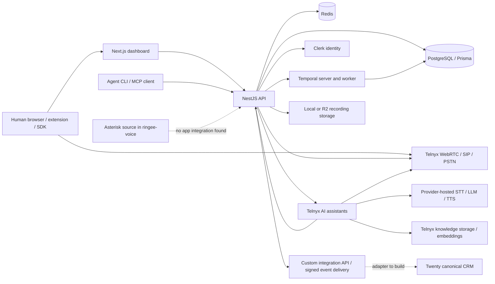

# Ringee source audit

Audit date: 2026-10-11. Scope: the two local source snapshots below, inspected statically. No dependencies were installed, applications deployed, credentials read, provider requests made, or calls placed. Upstream files were not modified. This is an implementation and integration audit, not a penetration test or runtime certification.

| Repository | Pinned HEAD | Local checkout |
|---|---|---|
| [ringee-app](https://github.com/ringee-io/ringee-app/commit/b04a4b889a9c827e76f64574f6f3b2f1c5f79241) | `b04a4b889a9c827e76f64574f6f3b2f1c5f79241` | `upstream/ringee-app` |
| [ringee-voice](https://github.com/ringee-io/ringee-voice/commit/050332665f8c9d535228808f7625b12129ddafe7) | `050332665f8c9d535228808f7625b12129ddafe7` | `upstream/ringee-voice` |

**Decision supported by this audit:** retain Ringee as the candidate communications subsystem and Twenty as the canonical CRM. Ringee already implements human calling, AI outbound conversations, an AI inbound receptionist, knowledge retrieval, outcomes, and receptionist-to-human transfer. The source does not justify building a replacement voice stack now. It does require migration, authentication, and legacy inbound-isolation work before a multi-tenant deployment. AI media and inference remain Telnyx services; cloning `ringee-voice` does not remove that dependency.

## Evidence terminology and limits

- **Source-confirmed:** an executable implementation or concrete configuration is present; this does not mean successfully exercised in this environment.
- **Partial:** part of the requested behavior is present, but a material component, scope, or guarantee is missing.
- **Absent in inspected source:** no implementation found in the stated source areas, or an explicit unsupported handler exists. This is bounded to these commits.
- **Unknown:** source alone cannot establish the operational behavior, performance, provider entitlement, production configuration, or hosted deployment state.
- **Hosted-only:** reserved here for an implementation shown to execute in an external provider. It does not mean “available only on Ringee's paid website.” No Ringee SaaS-exclusive feature split was established. The README's hosted/self-hosted parity assertion was not treated as validation.

Applicable upstream rules were read: root `AGENTS.md`, and those in backend, frontend, orchestrator, services, platform, database, dialer-core and dialer-sdk. They reinforce source-first inspection and workspace isolation. Their claims were cross-checked against code where material. For example, backend guidance says inbound custom integrations use HMAC, but the actual controller uses an API key; the report follows the controller. [A01] [A09] [A25]

## License inventory: exact files and stated conditions

This records license text in the snapshots and its stated conditions. It does not decide derivative-work boundaries, compatibility, or which obligations apply to a proposed distribution/service.

| Component | Exact license evidence | Conditions expressly present in the files |
|---|---|---|
| `ringee-app` root | `LICENSE`: **GNU Affero General Public License, Version 3, 19 November 2007** | Section 4 preserves copyright/license/warranty notices and includes the license with conveyed source; §5 adds modification/date notices, licensing of the covered modified work and interactive notices; §6 addresses corresponding source with non-source conveyance; §13 requires a modified version supporting remote network interaction to prominently offer its corresponding source to remote users without charge. [L01] [L02] [L03] [L04] |
| `ringee-app/apps/frontend` | Separate `LICENSE`: **MIT License**, copyright `(c) 2023 Kiranism` | Includes permission and warranty text; copyright and permission notices must accompany copies or substantial portions. This nested notice is recorded without concluding that the entire current frontend has a different license from the root. Preserve both notices and resolve provenance during release preparation. [L05] |
| `ringee-voice` root | `LICENSE` says **GNU General Public License version 2** and alternative licenses negotiated directly with Sangoma; full GPL v2 is in `COPYING` | `COPYING` §§1–3 cover notices/license copies, modified-file/date notices, licensing of distributed covered works, and source or qualifying offers with object code. `LICENSE` discusses loadable modules, named linking permissions, and an express external AMI/AGI/ARI protocol exception. Trademark policy is separately referenced. [L06] [L07] |
| Bundled components | Additional license files exist, e.g. `codecs/ilbc/LICENSE` and `LICENSE_ADDENDUM` | A complete third-party license/SBOM inventory has not been performed. Do not collapse all bundled code into a single root-license label. |

## Deployment and service map

| Layer | Source-confirmed dependencies and deployment shape | Boundary / qualification |
|---|---|---|
| App runtime | Compose builds backend on port 3000, orchestrator worker, frontend on 4200; backend/worker depend on PostgreSQL, Redis and Temporal. Node 22 Alpine backend build uses frozen pnpm lockfile. [D01] [D02] | Compose is supplied, but a clean deploy was not run. Public HTTPS callback reachability, persistence, backup/restore, proxy and secrets provisioning remain deployment work. |
| Local infrastructure | PostgreSQL 17 Alpine, Redis 7.4 Alpine, Temporal auto-setup 1.25; Temporal UI is opt-in debug. PostgreSQL and Redis have volumes. [D03] | This is more than a Next.js/database installation. The Temporal worker is needed for durable background work. |
| Identity / workspace | Clerk middleware and global guard; local user/organization records and ownership filters. [A02] [A03] | Clerk remains an external dependency; no local-auth replacement established. |
| Communications | Telnyx REST SDK/provider, browser WebRTC, carrier connections, number/call control. [H01] [H02] | Both telephony and voice-agent dispatchers select Telnyx. A provider abstraction exists, a working second provider does not. |
| AI voice runtime | Telnyx assistant CRUD, TeXML outbound AI call endpoint, Call Control inbound assistant start, provider callbacks. [V01] [V02] | Conversation media processing is provider-hosted. Ringee owns setup, routing, tools, tenancy, persistence and settlement. |
| Auxiliary AI | Deepgram REST and WebSocket transcription adapter; OpenAI/Anthropic keys and app AI model settings. [D04] [D05] [D11] | Direct Deepgram transcription is distinct from the live AI assistant's provider-managed STT. |
| Storage | Recording/upload factory supports local storage or Cloudflare R2; AI knowledge separately uses Telnyx S3-compatible storage with the configured Telnyx API key. [D06] [K01] | Local upload mode needs durable mounts beyond the provided database/Redis volumes. Knowledge does not use the recording store. |
| Optional integrations | Stripe, Firebase messaging, Resend, Google/Microsoft calendar OAuth, TriggerLoop, Attio, HubSpot, Odoo, Apollo/Prospeo configuration/code. [D04] [D07] [C01] | Presence does not prove all are mandatory to boot or that every optional feature works without configuration. Provider accounts, quotas and costs are unknown. |

**Reproducibility gap:** backend startup runs `db:deploy` (`prisma migrate deploy`), yet `git ls-files packages/database/prisma/migrations/` returns no tracked files. Schema work lives in `migrations-pending/` and `pending-migrations/`; `.gitignore` contains self-cancelling inclusion patterns. The root `prisma:migrate` alias also targets an absent package script. Therefore the supplied checkout is not a verified fresh-database bootstrap. Resolve a baseline and ordered migrations, including partial indexes, before attempting a production installation. This is corroborated by upstream `DEBT-002`; its historical folder counts were not reused as current counts. [D02] [D08] [D09] [G01]

## Authentication, workspace and RBAC

**Source-confirmed:** the Clerk guard rejects unauthenticated requests, resolves the active organization and role, checks account blocking, and resolves the local user. Organization data filters by organization ID; personal data filters by user ID **and** `organizationId: null`. `OrgAdminGuard` enforces `org:admin` for decorated organization endpoints, with explicit member exceptions. AI voice services require an organization, but the AI controller's observed guard is an organization-presence check, not an administrator-only check. Define the desired Twenty/Ringee role mapping explicitly. [A02] [A03] [A04] [A05]

**Critical gap: legacy MCP authorization.** New `/api/mcp` and `/api/mcp/sse` routes have `PersonalApiKeyGuard`. Legacy `/:id/sse`, `/:id/messages`, and user/org variants remain `@Public()`. They resolve authority directly from UUID path values; the org-only fallback selects a member or creator. UUID existence/membership is not proof that the caller owns the identity. Upstream documents this as an intentional capability URL (`DEBT-005`), but it is unsuitable as the default boundary for this multi-tenant business OS. Require the API-key path and disable or replace legacy routes with revocable authenticated capabilities before exposure. No live exploitation was attempted. [A06] [A07] [G02]

**Critical gap: legacy inbound media isolation.** The frontend still constructs a client with public build-time `NEXT_PUBLIC_TELNYX_LOGIN/PASSWORD`, alongside a per-user credential client. The default user destination documents provider delivery through shared credentials. A server-side answer claim improves application attribution but does not make shared SIP/WebRTC delivery tenant-isolated. Upstream explicitly records caller-number exposure and modified-client answer risk (`DEBT-020`). Complete per-user routing and credential migration for all DIDs before using shared multi-tenant inbound service. [H03] [H04] [H05] [G03]

## Capability matrix

| Requirement | Finding | Source evidence and practical scope |
|---|---|---|
| Human outbound | **Source-confirmed** | Shared browser engine invokes Telnyx `newCall`, supports E.164 destination/caller attribution and signed external-carrier routes. Real dialing is implemented. [H01] |
| Human inbound | **Source-confirmed, isolation partial** | User, extension, ring-group and desk-phone routing handlers; browser calls claim the inbound offer and call `answer()`. Legacy shared delivery remains a blocker above. [H03] [H05] [H06] |
| Own carrier / PBX | **Partial** | Carrier interfaces and Telnyx-backed connection/destination methods exist; browser external-carrier calls still enter through Telnyx. This is not a direct browser-to-Asterisk replacement. [H01] [H02] |
| Autonomous inbound AI conversation | **Source-confirmed** | AI receptionist route starts a live inbound assistant after workspace/call/credit checks; adapter answers the call and invokes `ai_assistant_start`. Only `call_control` transport is supported by this handler. [V02] [V03] [V04] |
| Autonomous outbound AI conversation | **Source-confirmed** | Service checks agent readiness, destination, DNC, calling permission, credits and owned caller ID; adapter invokes `/texml/ai_calls/{callingAppId}`. Receptionist agents are explicitly refused outbound. Supported blueprints include appointment booking and reminders/notifications. [V01] [V05] [V06] [V13] |
| Fully unattended campaign policy | **Partial** | An external workflow can trigger a real AI conversation, but the inspected AI start path has no calling-window check or user-supplied idempotency key. MCP marks start non-idempotent and says to confirm with a human; its input schema has no enforced confirmation token. Do not infer an approved autonomous bulk-campaign control plane. [V05] [M01] [M02] |
| Live STT | **Source-confirmed, provider-hosted** | Assistant mapper chooses `deepgram/flux`, with language fallback to `deepgram/nova-3`; Flux EOT thresholds/timeout are configured. [V07] |
| LLM BYOK | **Source-confirmed** | Ringee-hosted option plus OpenAI, Anthropic and Google BYOK; model family maps to operator-configured model IDs. Key is verified, sent to Telnyx integration secrets, and only a reference is stored on the agent. It traverses the Ringee backend; “Ringee never receives a provider key” would be inaccurate. [V08] [V09] [V12] |
| STT/TTS BYOK | **Absent in inspected AI configuration** | No per-agent STT credential or arbitrary TTS-provider credential field found in assistant configuration/mapper. App-level Deepgram key exists for separate transcription. LLM BYOK does not establish all-provider BYOK. [V07] [V09] [D05] |
| TTS / cloned voice | **Source-confirmed, provider-hosted** | Voice settings select provider voice IDs, Ultra expressive mode; curated catalog and authenticated clone/preview routes exist. No local TTS engine identified. [V07] [V10] |
| Barge-in / interruption | **Partial / runtime unknown** | Turn-end settings are explicit; no Ringee audio cancellation, VAD-driven interruption loop or configurable barge-in field was found in voice-agent implementation. Telnyx may implement interruption internally; source alone cannot certify behavior or latency. [V07] |
| Knowledge | **Source-confirmed** | URL, text, PDF, TXT/Markdown, Word upload paths; source-specific Telnyx buckets; asynchronous embeddings; retrieval tool attached after ready state. Reuse copies/re-indexes rather than sharing deletable storage. [K01] [K02] [V07] |
| Headless knowledge lifecycle | **Partial** | Indexing status is refreshed on read and then assistant is resynced. A headless import needs explicit polling or a background refresh job; do not assume unattended completion attaches the source. [K03] |
| Live tools | **Source-confirmed, bounded catalog** | Appointment availability/booking, callback scheduling, human-support notification, receptionist directory/transfer, retrieval and hangup. Tool authorization uses a hashed per-agent secret; receptionist adds active-call/workspace/direction checks. A general arbitrary business-tool builder was not established. [T01] [T02] [T03] |
| Live human transfer | **Source-confirmed for receptionist** | Search directory then transfer to a previously returned user, ring group or extension; checks availability, atomically claims transfer, rings via router and stops assistant. Transfer result differentiates ringing from connected. No blanket claim of outbound AI warm transfer. [T01] [T02] |
| General human escalation | **Source-confirmed follow-up** | Human support tool sends best-effort email/push to organization admins, deduplicated in Redis. This is a follow-up alert, not a live transfer. [T04] |
| Outcomes / transcripts | **Source-confirmed, delivery partial** | Token-authenticated insights/status callbacks; summary/sentiment/extracted data, transcript recovery from provider and tool-backed outcomes protected from speculative analysis overwrite. Insights depend on callback delivery; recovery of every lost analysis is not established. [O01] [O02] [O04] |
| MCP result completeness | **Partial** | AI result mapper returns call ID/status/outcome/summary/sentiment/extracted data/metadata, but no transcript field despite start-tool description mentioning transcript. Fetch transcript through the separate call/transcription surface when integrating. [M01] [O03] |
| IVR | **Absent as executable destination** | Registered IVR handler explicitly returns `destination_not_implemented` and supports no transports. [H07] |
| Native Twenty integration | **Absent in inspected source** | Registered CRM providers are Attio, HubSpot, Odoo legacy/JSON2. Searches of backend/platform/services/database source and Prisma schema found no Twenty adapter. [C01] |
| Self-hosted AI media runtime | **Absent in app source** | Provider dispatchers implement Telnyx only; `ringee-voice` is not referenced as a runtime component. See Asterisk section. [H02] [V11] |

## API, webhooks and MCP integration surfaces

1. **Authenticated dashboard/API:** global `/api` prefix and Clerk middleware; AI agent catalog, CRUD/configuration, calls, credentials, knowledge and voice operations are implemented in the AI controller. Workspace ownership is assembled server-side. [A05] [A10] [D10]
2. **MCP:** API-key Streamable HTTP and SSE plus legacy UUID URLs. Implemented AI tools list existing agents, initiate calls and fetch results; creation/editing need the authenticated management API/dashboard. The start call's human-confirmation sentence is descriptive policy, not a server-enforced confirmation mechanism. [A06] [A07] [M01] [M02]
3. **Telnyx events:** Ed25519 signature over timestamp plus raw body; rejects missing signatures/keys and timestamps outside configured tolerance. AI status and insights use distinct callback URL tokens because those provider flows do not use that signature envelope. [A08] [O01]
4. **Custom integration inbound:** `/api/integrations/custom/webhook` and `/click-to-call` resolve `x-ringee-api-key` to an active integration via a stored hash. Despite upstream prose about HMAC, these controller methods do not verify an inbound HMAC. [A25] [A26]
5. **Custom integration outbound:** signed `Ringee-Signature`/`Ringee-Timestamp` delivery, persisted deliveries, retry with exponential backoff, ten-attempt cap and failure notification. Consumer-side deduplication is still required. Event contract includes call completion/outcome/recording/missed/failed/DNC events; actor context can identify an AI agent. [C02] [C03] [C05]
6. **Human click-to-call:** custom integration creates a signed dialer session for the user's browser; this is distinct from server-triggered AI calling. [C04]

## Twenty remains canonical

The minimum bridge should use Ringee's existing Custom Integration boundaries, not introduce a second CRM:

- Twenty owns people, companies, relationships and business lifecycle. Publish the required contact/company mirror to Ringee with stable Twenty IDs in `externalId`; normalize phone values and define what deletion/merge means.
- Ringee owns telephony state, recordings, transcripts, voice-agent definitions and call settlement. Consume signed outbound Ringee events into Twenty activity/communication records, keyed by Ringee call/event IDs and integration/workspace mapping.
- Propagate Twenty record IDs in AI call `metadata`. Preserve the agent/user actor and store or link outcomes, transcript and recording according to the agreed retention policy. `metadata` is supported by the AI start schema and result mapper. [M02] [O03]
- Keep the integration service credential scoped to its Ringee workspace. Use its existing inbound API key and verify outbound event signatures; do not make UUID MCP URLs the machine integration credential.
- Define merge/dedup, replay, out-of-order events, deleted records, ownership reassignment, suppression/DNC propagation and reconciliation before synchronizing production records. The event contract is an available building block, not an already-shipped Twenty connector. [C02]

## What `ringee-voice` actually contains

The README identifies an Asterisk open-source PBX, and inspected C implementation confirms it: `chan_websocket` is a media channel driver; `app_audiosocket` sends/receives PCM over TCP; ARI's `externalMedia` API exposes RTP, AudioSocket and WebSocket channel transports. The WebSocket driver has flush/pause/continue media commands. These are useful media/control primitives, not a bundled STT→LLM→TTS conversational service. [R01] [R02] [R03] [R04] [R05]

The inspected app TS/TSX/JSON/Compose files contained no `asterisk`, `ari-client` or `AudioSocket` integration; the `ringee-voice` string matches were secret-identifier prefixes for Telnyx agents. Voice C/H/config/JSON/YAML search found no Ringee/Telnyx/Deepgram/OpenAI/Anthropic/ElevenLabs-specific implementation. This is bounded absence evidence. The clone is shallow (only one history entry visible), so ancestry/divergence from upstream Asterisk was **not** determined; do not claim it is byte-for-byte unmodified upstream.

**Relationship:** separate repository with Asterisk infrastructure potential; no source-confirmed place in the app's current call path or Compose stack. A direct Asterisk backend would require a telephony adapter, event normalizer, media session runtime and STT/LLM/TTS loop, credential/tenant isolation, recording/transfer/billing lifecycle mapping and acceptance tests. That is new subsystem work, not “switch on ringee-voice,” and is not the recommendation from this audit.

## Minimum changes and acceptance gates

| Priority | Required work | Evidence / acceptance condition |
|---|---|---|
| P0 | Replace/disable unauthenticated UUID MCP authority | Key/token-authenticated calls only; negative tests for leaked IDs, revoked keys and cross-workspace access. [A07] |
| P0 | Reconstruct a tracked migration baseline and upgrade path | Empty database can be initialized from this checkout; required partial indexes and voice/routing/API-key tables exist; upgrade and rollback procedure reviewed. [D08] [D09] |
| P0 before multi-tenant inbound | Finish per-user WebRTC credential and DID routing migration | A browser from another workspace never receives the media offer or caller identity; simultaneous claim/transfer tests pass. [H04] [G03] |
| P1 | Build the Twenty adapter on custom integrations | Stable ID map, verified signatures, dedup/replay, outbound actor metadata and reconciliation work. [C02] [C03] |
| P1 before unattended outbound | Add an explicit execution-policy boundary | Calling windows, authorization/approval policy, budgets/rate limits and request idempotency are checked server-side; ambiguous provider result never triggers a blind redial. Existing DNC/credit gates retained. [V05] [V14] [M01] [M02] |
| P1 for headless knowledge | Poll/resync readiness durably | A submitted source becomes attached without a user opening its page; failures surface and retry safely. [K03] |
| P1 validation | Exercise the existing Telnyx stack with controlled test fixtures/account | Human inbound/outbound, AI inbound/outbound, interruptions, no-answer, provider outage, callback replay, transfer ringing/connected/failure, transcript/outcome ingestion and settlement reconciled. No live claim made by this audit. |
| P2 only if required | Broader tools, STT/TTS BYOK, outbound warm handoff, local media | Implement only after the existing capability pilot establishes an actual requirement gap. Do not replace the stack based on repository names or feature marketing. |

Remaining unknowns include live latency/audio quality, barge-in behavior, load capacity, provider account entitlements and costs, deployed schema state, hosted/self-hosted operational parity, app-wide security coverage and full third-party licensing provenance. The static evidence is sufficient to select integration work and pre-deployment fixes, but not to certify a live call-center deployment.

## Source reference index

All links below are pinned to the audited commit, and labels include repository-relative paths and line numbers. Local equivalents live under the checkout paths in the first table.

| ID | Pinned source and line range |
|---|---|
| A01 | [`ringee-app/AGENTS.md:30–107`](https://github.com/ringee-io/ringee-app/blob/b04a4b889a9c827e76f64574f6f3b2f1c5f79241/AGENTS.md#L30-L107) |
| A02 | [`ringee-app/apps/backend/src/clerk.auth.guard.ts:29–69`](https://github.com/ringee-io/ringee-app/blob/b04a4b889a9c827e76f64574f6f3b2f1c5f79241/apps/backend/src/clerk.auth.guard.ts#L29-L69) |
| A03 | [`ringee-app/packages/platform/src/auth/ownership.types.ts:24–100`](https://github.com/ringee-io/ringee-app/blob/b04a4b889a9c827e76f64574f6f3b2f1c5f79241/packages/platform/src/auth/ownership.types.ts#L24-L100) |
| A04 | [`ringee-app/packages/platform/src/auth/org-admin.guard.ts:22–58`](https://github.com/ringee-io/ringee-app/blob/b04a4b889a9c827e76f64574f6f3b2f1c5f79241/packages/platform/src/auth/org-admin.guard.ts#L22-L58) |
| A05 | [`ringee-app/apps/backend/src/api/routes/ai-voice-agent.controller.ts:50–79`](https://github.com/ringee-io/ringee-app/blob/b04a4b889a9c827e76f64574f6f3b2f1c5f79241/apps/backend/src/api/routes/ai-voice-agent.controller.ts#L50-L79) |
| A06 | [`ringee-app/apps/backend/src/api/routes/mcp.controller.ts:81–145`](https://github.com/ringee-io/ringee-app/blob/b04a4b889a9c827e76f64574f6f3b2f1c5f79241/apps/backend/src/api/routes/mcp.controller.ts#L81-L145) |
| A07 | [`ringee-app/apps/backend/src/api/routes/mcp.controller.ts:167–323`](https://github.com/ringee-io/ringee-app/blob/b04a4b889a9c827e76f64574f6f3b2f1c5f79241/apps/backend/src/api/routes/mcp.controller.ts#L167-L323) |
| A08 | [`ringee-app/packages/platform/src/telephony/telnyx/telnyx.webhook.verifier.ts:26–69`](https://github.com/ringee-io/ringee-app/blob/b04a4b889a9c827e76f64574f6f3b2f1c5f79241/packages/platform/src/telephony/telnyx/telnyx.webhook.verifier.ts#L26-L69) |
| A25 | [`ringee-app/apps/backend/src/api/routes/custom-integrations.webhook.controller.ts:16–60`](https://github.com/ringee-io/ringee-app/blob/b04a4b889a9c827e76f64574f6f3b2f1c5f79241/apps/backend/src/api/routes/custom-integrations.webhook.controller.ts#L16-L60) |
| A26 | [`ringee-app/packages/services/src/services/custom-integrations/custom-integration-auth.service.ts:21–45`](https://github.com/ringee-io/ringee-app/blob/b04a4b889a9c827e76f64574f6f3b2f1c5f79241/packages/services/src/services/custom-integrations/custom-integration-auth.service.ts#L21-L45) |
| L01 | [`ringee-app/LICENSE:1–6`](https://github.com/ringee-io/ringee-app/blob/b04a4b889a9c827e76f64574f6f3b2f1c5f79241/LICENSE#L1-L6) |
| L02 | [`ringee-app/LICENSE:183–221`](https://github.com/ringee-io/ringee-app/blob/b04a4b889a9c827e76f64574f6f3b2f1c5f79241/LICENSE#L183-L221) |
| L03 | [`ringee-app/LICENSE:233–276`](https://github.com/ringee-io/ringee-app/blob/b04a4b889a9c827e76f64574f6f3b2f1c5f79241/LICENSE#L233-L276) |
| L04 | [`ringee-app/LICENSE:540–559`](https://github.com/ringee-io/ringee-app/blob/b04a4b889a9c827e76f64574f6f3b2f1c5f79241/LICENSE#L540-L559) |
| L05 | [`ringee-app/apps/frontend/LICENSE:1–21`](https://github.com/ringee-io/ringee-app/blob/b04a4b889a9c827e76f64574f6f3b2f1c5f79241/apps/frontend/LICENSE#L1-L21) |
| L06 | [`ringee-voice/LICENSE:1–47`](https://github.com/ringee-io/ringee-voice/blob/050332665f8c9d535228808f7625b12129ddafe7/LICENSE#L1-L47) |
| L07 | [`ringee-voice/COPYING:80–170`](https://github.com/ringee-io/ringee-voice/blob/050332665f8c9d535228808f7625b12129ddafe7/COPYING#L80-L170) |
| D01 | [`ringee-app/docker-compose.app.yml:6–110`](https://github.com/ringee-io/ringee-app/blob/b04a4b889a9c827e76f64574f6f3b2f1c5f79241/docker-compose.app.yml#L6-L110) |
| D02 | [`ringee-app/apps/backend/Dockerfile.compose:4–43`](https://github.com/ringee-io/ringee-app/blob/b04a4b889a9c827e76f64574f6f3b2f1c5f79241/apps/backend/Dockerfile.compose#L4-L43) |
| D03 | [`ringee-app/docker-compose.yml:3–108`](https://github.com/ringee-io/ringee-app/blob/b04a4b889a9c827e76f64574f6f3b2f1c5f79241/docker-compose.yml#L3-L108) |
| D04 | [`ringee-app/packages/configuration/src/api.configuration.ts:11–281`](https://github.com/ringee-io/ringee-app/blob/b04a4b889a9c827e76f64574f6f3b2f1c5f79241/packages/configuration/src/api.configuration.ts#L11-L281) |
| D05 | [`ringee-app/packages/platform/src/deepgram/deepgram.service.ts:13–74`](https://github.com/ringee-io/ringee-app/blob/b04a4b889a9c827e76f64574f6f3b2f1c5f79241/packages/platform/src/deepgram/deepgram.service.ts#L13-L74) |
| D06 | [`ringee-app/packages/platform/src/upload/upload.factory.ts:1–25`](https://github.com/ringee-io/ringee-app/blob/b04a4b889a9c827e76f64574f6f3b2f1c5f79241/packages/platform/src/upload/upload.factory.ts#L1-L25) |
| D07 | [`ringee-app/apps/backend/package.json:13–58`](https://github.com/ringee-io/ringee-app/blob/b04a4b889a9c827e76f64574f6f3b2f1c5f79241/apps/backend/package.json#L13-L58) |
| D08 | [`ringee-app/.gitignore:14–27`](https://github.com/ringee-io/ringee-app/blob/b04a4b889a9c827e76f64574f6f3b2f1c5f79241/.gitignore#L14-L27) |
| D09 | [`ringee-app/packages/database/package.json:5–18`](https://github.com/ringee-io/ringee-app/blob/b04a4b889a9c827e76f64574f6f3b2f1c5f79241/packages/database/package.json#L5-L18) |
| D10 | [`ringee-app/apps/backend/src/main.ts:60–80`](https://github.com/ringee-io/ringee-app/blob/b04a4b889a9c827e76f64574f6f3b2f1c5f79241/apps/backend/src/main.ts#L60-L80) |
| G01 | [`ringee-app/docs/engineering/ARCHITECTURE_DEBT.md:73–97`](https://github.com/ringee-io/ringee-app/blob/b04a4b889a9c827e76f64574f6f3b2f1c5f79241/docs/engineering/ARCHITECTURE_DEBT.md#L73-L97) |
| G02 | [`ringee-app/docs/engineering/ARCHITECTURE_DEBT.md:99–115`](https://github.com/ringee-io/ringee-app/blob/b04a4b889a9c827e76f64574f6f3b2f1c5f79241/docs/engineering/ARCHITECTURE_DEBT.md#L99-L115) |
| G03 | [`ringee-app/docs/engineering/ARCHITECTURE_DEBT.md:19–71`](https://github.com/ringee-io/ringee-app/blob/b04a4b889a9c827e76f64574f6f3b2f1c5f79241/docs/engineering/ARCHITECTURE_DEBT.md#L19-L71) |
| H01 | [`ringee-app/packages/dialer-core/src/engine/telnyx-engine.ts:25–110`](https://github.com/ringee-io/ringee-app/blob/b04a4b889a9c827e76f64574f6f3b2f1c5f79241/packages/dialer-core/src/engine/telnyx-engine.ts#L25-L110) |
| H02 | [`ringee-app/packages/platform/src/telephony/telephony.service.ts:73–128`](https://github.com/ringee-io/ringee-app/blob/b04a4b889a9c827e76f64574f6f3b2f1c5f79241/packages/platform/src/telephony/telephony.service.ts#L73-L128) |
| H03 | [`ringee-app/packages/services/src/services/inbound-routing/destinations/user.destination.ts:14–65`](https://github.com/ringee-io/ringee-app/blob/b04a4b889a9c827e76f64574f6f3b2f1c5f79241/packages/services/src/services/inbound-routing/destinations/user.destination.ts#L14-L65) |
| H04 | [`ringee-app/apps/frontend/src/features/calls/hooks/use.telnyx.tsx:34–150`](https://github.com/ringee-io/ringee-app/blob/b04a4b889a9c827e76f64574f6f3b2f1c5f79241/apps/frontend/src/features/calls/hooks/use.telnyx.tsx#L34-L150) |
| H05 | [`ringee-app/apps/frontend/src/features/calls/components/incoming.call.tsx:110–149`](https://github.com/ringee-io/ringee-app/blob/b04a4b889a9c827e76f64574f6f3b2f1c5f79241/apps/frontend/src/features/calls/components/incoming.call.tsx#L110-L149) |
| H06 | [`ringee-app/packages/services/src/services/inbound-routing/inbound-call-router.service.ts:70–131`](https://github.com/ringee-io/ringee-app/blob/b04a4b889a9c827e76f64574f6f3b2f1c5f79241/packages/services/src/services/inbound-routing/inbound-call-router.service.ts#L70-L131) |
| H07 | [`ringee-app/packages/services/src/services/inbound-routing/destinations/unsupported.destination.ts:10–41`](https://github.com/ringee-io/ringee-app/blob/b04a4b889a9c827e76f64574f6f3b2f1c5f79241/packages/services/src/services/inbound-routing/destinations/unsupported.destination.ts#L10-L41) |
| V01 | [`ringee-app/packages/platform/src/voice-agents/telnyx/telnyx.voice-agent.service.ts:259–308`](https://github.com/ringee-io/ringee-app/blob/b04a4b889a9c827e76f64574f6f3b2f1c5f79241/packages/platform/src/voice-agents/telnyx/telnyx.voice-agent.service.ts#L259-L308) |
| V02 | [`ringee-app/packages/platform/src/voice-agents/telnyx/telnyx.voice-agent.service.ts:113–152`](https://github.com/ringee-io/ringee-app/blob/b04a4b889a9c827e76f64574f6f3b2f1c5f79241/packages/platform/src/voice-agents/telnyx/telnyx.voice-agent.service.ts#L113-L152) |
| V03 | [`ringee-app/packages/services/src/services/voice-agents/voice-agent-call.service.ts:120–168`](https://github.com/ringee-io/ringee-app/blob/b04a4b889a9c827e76f64574f6f3b2f1c5f79241/packages/services/src/services/voice-agents/voice-agent-call.service.ts#L120-L168) |
| V04 | [`ringee-app/packages/services/src/services/inbound-routing/destinations/ai-receptionist.destination.ts:14–52`](https://github.com/ringee-io/ringee-app/blob/b04a4b889a9c827e76f64574f6f3b2f1c5f79241/packages/services/src/services/inbound-routing/destinations/ai-receptionist.destination.ts#L14-L52) |
| V05 | [`ringee-app/packages/services/src/services/voice-agents/voice-agent-call.service.ts:189–294`](https://github.com/ringee-io/ringee-app/blob/b04a4b889a9c827e76f64574f6f3b2f1c5f79241/packages/services/src/services/voice-agents/voice-agent-call.service.ts#L189-L294) |
| V06 | [`ringee-app/packages/services/src/services/voice-agents/blueprints/appointment-booking.blueprint.ts:235–300`](https://github.com/ringee-io/ringee-app/blob/b04a4b889a9c827e76f64574f6f3b2f1c5f79241/packages/services/src/services/voice-agents/blueprints/appointment-booking.blueprint.ts#L235-L300) |
| V07 | [`ringee-app/packages/platform/src/voice-agents/telnyx/telnyx.voice-agent.mapper.ts:44–239`](https://github.com/ringee-io/ringee-app/blob/b04a4b889a9c827e76f64574f6f3b2f1c5f79241/packages/platform/src/voice-agents/telnyx/telnyx.voice-agent.mapper.ts#L44-L239) |
| V08 | [`ringee-app/packages/platform/src/voice-agents/models.catalog.ts:16–76`](https://github.com/ringee-io/ringee-app/blob/b04a4b889a9c827e76f64574f6f3b2f1c5f79241/packages/platform/src/voice-agents/models.catalog.ts#L16-L76) |
| V09 | [`ringee-app/packages/services/src/services/voice-agents/voice-agent.service.ts:853–901`](https://github.com/ringee-io/ringee-app/blob/b04a4b889a9c827e76f64574f6f3b2f1c5f79241/packages/services/src/services/voice-agents/voice-agent.service.ts#L853-L901) |
| V10 | [`ringee-app/apps/backend/src/api/routes/ai-voice-agent.controller.ts:82–137`](https://github.com/ringee-io/ringee-app/blob/b04a4b889a9c827e76f64574f6f3b2f1c5f79241/apps/backend/src/api/routes/ai-voice-agent.controller.ts#L82-L137) |
| V11 | [`ringee-app/packages/platform/src/voice-agents/voice-agent-provider.service.ts:24–40`](https://github.com/ringee-io/ringee-app/blob/b04a4b889a9c827e76f64574f6f3b2f1c5f79241/packages/platform/src/voice-agents/voice-agent-provider.service.ts#L24-L40) |
| M01 | [`ringee-app/apps/backend/src/mcp/mcp.func.ts:2380–2445`](https://github.com/ringee-io/ringee-app/blob/b04a4b889a9c827e76f64574f6f3b2f1c5f79241/apps/backend/src/mcp/mcp.func.ts#L2380-L2445) |
| M02 | [`ringee-app/apps/backend/src/mcp/mcp.zod.ts:1231–1259`](https://github.com/ringee-io/ringee-app/blob/b04a4b889a9c827e76f64574f6f3b2f1c5f79241/apps/backend/src/mcp/mcp.zod.ts#L1231-L1259) |
| K01 | [`ringee-app/packages/platform/src/voice-agents/telnyx/telnyx.knowledge.store.ts:13–83`](https://github.com/ringee-io/ringee-app/blob/b04a4b889a9c827e76f64574f6f3b2f1c5f79241/packages/platform/src/voice-agents/telnyx/telnyx.knowledge.store.ts#L13-L83) |
| K02 | [`ringee-app/packages/services/src/services/voice-agents/voice-agent-knowledge.service.ts:27–224`](https://github.com/ringee-io/ringee-app/blob/b04a4b889a9c827e76f64574f6f3b2f1c5f79241/packages/services/src/services/voice-agents/voice-agent-knowledge.service.ts#L27-L224) |
| K03 | [`ringee-app/packages/services/src/services/voice-agents/voice-agent-knowledge.service.ts:543–590`](https://github.com/ringee-io/ringee-app/blob/b04a4b889a9c827e76f64574f6f3b2f1c5f79241/packages/services/src/services/voice-agents/voice-agent-knowledge.service.ts#L543-L590) |
| T01 | [`ringee-app/packages/services/src/services/voice-agents/blueprints/receptionist.tools.ts:5–56`](https://github.com/ringee-io/ringee-app/blob/b04a4b889a9c827e76f64574f6f3b2f1c5f79241/packages/services/src/services/voice-agents/blueprints/receptionist.tools.ts#L5-L56) |
| T02 | [`ringee-app/packages/services/src/services/voice-agents/voice-agent-tool.service.ts:119–318`](https://github.com/ringee-io/ringee-app/blob/b04a4b889a9c827e76f64574f6f3b2f1c5f79241/packages/services/src/services/voice-agents/voice-agent-tool.service.ts#L119-L318) |
| T03 | [`ringee-app/packages/services/src/services/voice-agents/voice-agent-tool.service.ts:321–850`](https://github.com/ringee-io/ringee-app/blob/b04a4b889a9c827e76f64574f6f3b2f1c5f79241/packages/services/src/services/voice-agents/voice-agent-tool.service.ts#L321-L850) |
| T04 | [`ringee-app/packages/services/src/services/voice-agents/voice-agent-human-support.service.ts:43–127`](https://github.com/ringee-io/ringee-app/blob/b04a4b889a9c827e76f64574f6f3b2f1c5f79241/packages/services/src/services/voice-agents/voice-agent-human-support.service.ts#L43-L127) |
| O01 | [`ringee-app/apps/backend/src/api/routes/ai-voice-agent-webhook.controller.ts:13–79`](https://github.com/ringee-io/ringee-app/blob/b04a4b889a9c827e76f64574f6f3b2f1c5f79241/apps/backend/src/api/routes/ai-voice-agent-webhook.controller.ts#L13-L79) |
| O02 | [`ringee-app/packages/services/src/services/voice-agents/voice-agent-result.service.ts:100–179`](https://github.com/ringee-io/ringee-app/blob/b04a4b889a9c827e76f64574f6f3b2f1c5f79241/packages/services/src/services/voice-agents/voice-agent-result.service.ts#L100-L179) |
| O03 | [`ringee-app/packages/services/src/services/voice-agents/voice-agent-result.service.ts:578–589`](https://github.com/ringee-io/ringee-app/blob/b04a4b889a9c827e76f64574f6f3b2f1c5f79241/packages/services/src/services/voice-agents/voice-agent-result.service.ts#L578-L589) |
| C01 | [`ringee-app/packages/platform/src/crm/crm.module.ts:59–73`](https://github.com/ringee-io/ringee-app/blob/b04a4b889a9c827e76f64574f6f3b2f1c5f79241/packages/platform/src/crm/crm.module.ts#L59-L73) |
| C02 | [`ringee-app/packages/platform/src/custom-integrations/event-spec.ts:30–150`](https://github.com/ringee-io/ringee-app/blob/b04a4b889a9c827e76f64574f6f3b2f1c5f79241/packages/platform/src/custom-integrations/event-spec.ts#L30-L150) |
| C03 | [`ringee-app/packages/services/src/services/custom-integrations/custom-integration-delivery.service.ts:11–149`](https://github.com/ringee-io/ringee-app/blob/b04a4b889a9c827e76f64574f6f3b2f1c5f79241/packages/services/src/services/custom-integrations/custom-integration-delivery.service.ts#L11-L149) |
| C04 | [`ringee-app/packages/services/src/services/custom-integrations/custom-integration-click-to-call.service.ts:80–110`](https://github.com/ringee-io/ringee-app/blob/b04a4b889a9c827e76f64574f6f3b2f1c5f79241/packages/services/src/services/custom-integrations/custom-integration-click-to-call.service.ts#L80-L110) |
| R01 | [`ringee-voice/README.md:1–25`](https://github.com/ringee-io/ringee-voice/blob/050332665f8c9d535228808f7625b12129ddafe7/README.md#L1-L25) |
| R02 | [`ringee-voice/channels/chan_websocket.c:19–51`](https://github.com/ringee-io/ringee-voice/blob/050332665f8c9d535228808f7625b12129ddafe7/channels/chan_websocket.c#L19-L51) |
| R03 | [`ringee-voice/apps/app_audiosocket.c:50–71`](https://github.com/ringee-io/ringee-voice/blob/050332665f8c9d535228808f7625b12129ddafe7/apps/app_audiosocket.c#L50-L71) |
| R04 | [`ringee-voice/rest-api/api-docs/channels.json:2006–2135`](https://github.com/ringee-io/ringee-voice/blob/050332665f8c9d535228808f7625b12129ddafe7/rest-api/api-docs/channels.json#L2006-L2135) |
| A09 | [`ringee-app/apps/backend/AGENTS.md:36–52`](https://github.com/ringee-io/ringee-app/blob/b04a4b889a9c827e76f64574f6f3b2f1c5f79241/apps/backend/AGENTS.md#L36-L52) |
| A10 | [`ringee-app/apps/backend/src/api/routes/ai-voice-agent.controller.ts:211–384`](https://github.com/ringee-io/ringee-app/blob/b04a4b889a9c827e76f64574f6f3b2f1c5f79241/apps/backend/src/api/routes/ai-voice-agent.controller.ts#L211-L384) |
| D11 | [`ringee-app/packages/platform/src/deepgram/deepgram.service.ts:205–238`](https://github.com/ringee-io/ringee-app/blob/b04a4b889a9c827e76f64574f6f3b2f1c5f79241/packages/platform/src/deepgram/deepgram.service.ts#L205-L238) |
| V12 | [`ringee-app/packages/platform/src/voice-agents/telnyx/telnyx.voice-agent.service.ts:468–475`](https://github.com/ringee-io/ringee-app/blob/b04a4b889a9c827e76f64574f6f3b2f1c5f79241/packages/platform/src/voice-agents/telnyx/telnyx.voice-agent.service.ts#L468-L475) |
| V13 | [`ringee-app/packages/services/src/services/voice-agents/blueprints/reminders-notifications.blueprint.ts:176–204`](https://github.com/ringee-io/ringee-app/blob/b04a4b889a9c827e76f64574f6f3b2f1c5f79241/packages/services/src/services/voice-agents/blueprints/reminders-notifications.blueprint.ts#L176-L204) |
| V14 | [`ringee-app/packages/services/src/services/voice-agents/voice-agent-call.service.ts:423–462`](https://github.com/ringee-io/ringee-app/blob/b04a4b889a9c827e76f64574f6f3b2f1c5f79241/packages/services/src/services/voice-agents/voice-agent-call.service.ts#L423-L462) |
| O04 | [`ringee-app/packages/services/src/services/voice-agents/voice-agent-result.service.ts:288–399`](https://github.com/ringee-io/ringee-app/blob/b04a4b889a9c827e76f64574f6f3b2f1c5f79241/packages/services/src/services/voice-agents/voice-agent-result.service.ts#L288-L399) |
| C05 | [`ringee-app/packages/platform/src/custom-integrations/event-spec.ts:345–500`](https://github.com/ringee-io/ringee-app/blob/b04a4b889a9c827e76f64574f6f3b2f1c5f79241/packages/platform/src/custom-integrations/event-spec.ts#L345-L500) |
| R05 | [`ringee-voice/channels/chan_websocket.c:860–911`](https://github.com/ringee-io/ringee-voice/blob/050332665f8c9d535228808f7625b12129ddafe7/channels/chan_websocket.c#L860-L911) |

[A01]: https://github.com/ringee-io/ringee-app/blob/b04a4b889a9c827e76f64574f6f3b2f1c5f79241/AGENTS.md#L30-L107
[A02]: https://github.com/ringee-io/ringee-app/blob/b04a4b889a9c827e76f64574f6f3b2f1c5f79241/apps/backend/src/clerk.auth.guard.ts#L29-L69
[A03]: https://github.com/ringee-io/ringee-app/blob/b04a4b889a9c827e76f64574f6f3b2f1c5f79241/packages/platform/src/auth/ownership.types.ts#L24-L100
[A04]: https://github.com/ringee-io/ringee-app/blob/b04a4b889a9c827e76f64574f6f3b2f1c5f79241/packages/platform/src/auth/org-admin.guard.ts#L22-L58
[A05]: https://github.com/ringee-io/ringee-app/blob/b04a4b889a9c827e76f64574f6f3b2f1c5f79241/apps/backend/src/api/routes/ai-voice-agent.controller.ts#L50-L79
[A06]: https://github.com/ringee-io/ringee-app/blob/b04a4b889a9c827e76f64574f6f3b2f1c5f79241/apps/backend/src/api/routes/mcp.controller.ts#L81-L145
[A07]: https://github.com/ringee-io/ringee-app/blob/b04a4b889a9c827e76f64574f6f3b2f1c5f79241/apps/backend/src/api/routes/mcp.controller.ts#L167-L323
[A08]: https://github.com/ringee-io/ringee-app/blob/b04a4b889a9c827e76f64574f6f3b2f1c5f79241/packages/platform/src/telephony/telnyx/telnyx.webhook.verifier.ts#L26-L69
[A25]: https://github.com/ringee-io/ringee-app/blob/b04a4b889a9c827e76f64574f6f3b2f1c5f79241/apps/backend/src/api/routes/custom-integrations.webhook.controller.ts#L16-L60
[A26]: https://github.com/ringee-io/ringee-app/blob/b04a4b889a9c827e76f64574f6f3b2f1c5f79241/packages/services/src/services/custom-integrations/custom-integration-auth.service.ts#L21-L45
[L01]: https://github.com/ringee-io/ringee-app/blob/b04a4b889a9c827e76f64574f6f3b2f1c5f79241/LICENSE#L1-L6
[L02]: https://github.com/ringee-io/ringee-app/blob/b04a4b889a9c827e76f64574f6f3b2f1c5f79241/LICENSE#L183-L221
[L03]: https://github.com/ringee-io/ringee-app/blob/b04a4b889a9c827e76f64574f6f3b2f1c5f79241/LICENSE#L233-L276
[L04]: https://github.com/ringee-io/ringee-app/blob/b04a4b889a9c827e76f64574f6f3b2f1c5f79241/LICENSE#L540-L559
[L05]: https://github.com/ringee-io/ringee-app/blob/b04a4b889a9c827e76f64574f6f3b2f1c5f79241/apps/frontend/LICENSE#L1-L21
[L06]: https://github.com/ringee-io/ringee-voice/blob/050332665f8c9d535228808f7625b12129ddafe7/LICENSE#L1-L47
[L07]: https://github.com/ringee-io/ringee-voice/blob/050332665f8c9d535228808f7625b12129ddafe7/COPYING#L80-L170
[D01]: https://github.com/ringee-io/ringee-app/blob/b04a4b889a9c827e76f64574f6f3b2f1c5f79241/docker-compose.app.yml#L6-L110
[D02]: https://github.com/ringee-io/ringee-app/blob/b04a4b889a9c827e76f64574f6f3b2f1c5f79241/apps/backend/Dockerfile.compose#L4-L43
[D03]: https://github.com/ringee-io/ringee-app/blob/b04a4b889a9c827e76f64574f6f3b2f1c5f79241/docker-compose.yml#L3-L108
[D04]: https://github.com/ringee-io/ringee-app/blob/b04a4b889a9c827e76f64574f6f3b2f1c5f79241/packages/configuration/src/api.configuration.ts#L11-L281
[D05]: https://github.com/ringee-io/ringee-app/blob/b04a4b889a9c827e76f64574f6f3b2f1c5f79241/packages/platform/src/deepgram/deepgram.service.ts#L13-L74
[D06]: https://github.com/ringee-io/ringee-app/blob/b04a4b889a9c827e76f64574f6f3b2f1c5f79241/packages/platform/src/upload/upload.factory.ts#L1-L25
[D07]: https://github.com/ringee-io/ringee-app/blob/b04a4b889a9c827e76f64574f6f3b2f1c5f79241/apps/backend/package.json#L13-L58
[D08]: https://github.com/ringee-io/ringee-app/blob/b04a4b889a9c827e76f64574f6f3b2f1c5f79241/.gitignore#L14-L27
[D09]: https://github.com/ringee-io/ringee-app/blob/b04a4b889a9c827e76f64574f6f3b2f1c5f79241/packages/database/package.json#L5-L18
[D10]: https://github.com/ringee-io/ringee-app/blob/b04a4b889a9c827e76f64574f6f3b2f1c5f79241/apps/backend/src/main.ts#L60-L80
[G01]: https://github.com/ringee-io/ringee-app/blob/b04a4b889a9c827e76f64574f6f3b2f1c5f79241/docs/engineering/ARCHITECTURE_DEBT.md#L73-L97
[G02]: https://github.com/ringee-io/ringee-app/blob/b04a4b889a9c827e76f64574f6f3b2f1c5f79241/docs/engineering/ARCHITECTURE_DEBT.md#L99-L115
[G03]: https://github.com/ringee-io/ringee-app/blob/b04a4b889a9c827e76f64574f6f3b2f1c5f79241/docs/engineering/ARCHITECTURE_DEBT.md#L19-L71
[H01]: https://github.com/ringee-io/ringee-app/blob/b04a4b889a9c827e76f64574f6f3b2f1c5f79241/packages/dialer-core/src/engine/telnyx-engine.ts#L25-L110
[H02]: https://github.com/ringee-io/ringee-app/blob/b04a4b889a9c827e76f64574f6f3b2f1c5f79241/packages/platform/src/telephony/telephony.service.ts#L73-L128
[H03]: https://github.com/ringee-io/ringee-app/blob/b04a4b889a9c827e76f64574f6f3b2f1c5f79241/packages/services/src/services/inbound-routing/destinations/user.destination.ts#L14-L65
[H04]: https://github.com/ringee-io/ringee-app/blob/b04a4b889a9c827e76f64574f6f3b2f1c5f79241/apps/frontend/src/features/calls/hooks/use.telnyx.tsx#L34-L150
[H05]: https://github.com/ringee-io/ringee-app/blob/b04a4b889a9c827e76f64574f6f3b2f1c5f79241/apps/frontend/src/features/calls/components/incoming.call.tsx#L110-L149
[H06]: https://github.com/ringee-io/ringee-app/blob/b04a4b889a9c827e76f64574f6f3b2f1c5f79241/packages/services/src/services/inbound-routing/inbound-call-router.service.ts#L70-L131
[H07]: https://github.com/ringee-io/ringee-app/blob/b04a4b889a9c827e76f64574f6f3b2f1c5f79241/packages/services/src/services/inbound-routing/destinations/unsupported.destination.ts#L10-L41
[V01]: https://github.com/ringee-io/ringee-app/blob/b04a4b889a9c827e76f64574f6f3b2f1c5f79241/packages/platform/src/voice-agents/telnyx/telnyx.voice-agent.service.ts#L259-L308
[V02]: https://github.com/ringee-io/ringee-app/blob/b04a4b889a9c827e76f64574f6f3b2f1c5f79241/packages/platform/src/voice-agents/telnyx/telnyx.voice-agent.service.ts#L113-L152
[V03]: https://github.com/ringee-io/ringee-app/blob/b04a4b889a9c827e76f64574f6f3b2f1c5f79241/packages/services/src/services/voice-agents/voice-agent-call.service.ts#L120-L168
[V04]: https://github.com/ringee-io/ringee-app/blob/b04a4b889a9c827e76f64574f6f3b2f1c5f79241/packages/services/src/services/inbound-routing/destinations/ai-receptionist.destination.ts#L14-L52
[V05]: https://github.com/ringee-io/ringee-app/blob/b04a4b889a9c827e76f64574f6f3b2f1c5f79241/packages/services/src/services/voice-agents/voice-agent-call.service.ts#L189-L294
[V06]: https://github.com/ringee-io/ringee-app/blob/b04a4b889a9c827e76f64574f6f3b2f1c5f79241/packages/services/src/services/voice-agents/blueprints/appointment-booking.blueprint.ts#L235-L300
[V07]: https://github.com/ringee-io/ringee-app/blob/b04a4b889a9c827e76f64574f6f3b2f1c5f79241/packages/platform/src/voice-agents/telnyx/telnyx.voice-agent.mapper.ts#L44-L239
[V08]: https://github.com/ringee-io/ringee-app/blob/b04a4b889a9c827e76f64574f6f3b2f1c5f79241/packages/platform/src/voice-agents/models.catalog.ts#L16-L76
[V09]: https://github.com/ringee-io/ringee-app/blob/b04a4b889a9c827e76f64574f6f3b2f1c5f79241/packages/services/src/services/voice-agents/voice-agent.service.ts#L853-L901
[V10]: https://github.com/ringee-io/ringee-app/blob/b04a4b889a9c827e76f64574f6f3b2f1c5f79241/apps/backend/src/api/routes/ai-voice-agent.controller.ts#L82-L137
[V11]: https://github.com/ringee-io/ringee-app/blob/b04a4b889a9c827e76f64574f6f3b2f1c5f79241/packages/platform/src/voice-agents/voice-agent-provider.service.ts#L24-L40
[M01]: https://github.com/ringee-io/ringee-app/blob/b04a4b889a9c827e76f64574f6f3b2f1c5f79241/apps/backend/src/mcp/mcp.func.ts#L2380-L2445
[M02]: https://github.com/ringee-io/ringee-app/blob/b04a4b889a9c827e76f64574f6f3b2f1c5f79241/apps/backend/src/mcp/mcp.zod.ts#L1231-L1259
[K01]: https://github.com/ringee-io/ringee-app/blob/b04a4b889a9c827e76f64574f6f3b2f1c5f79241/packages/platform/src/voice-agents/telnyx/telnyx.knowledge.store.ts#L13-L83
[K02]: https://github.com/ringee-io/ringee-app/blob/b04a4b889a9c827e76f64574f6f3b2f1c5f79241/packages/services/src/services/voice-agents/voice-agent-knowledge.service.ts#L27-L224
[K03]: https://github.com/ringee-io/ringee-app/blob/b04a4b889a9c827e76f64574f6f3b2f1c5f79241/packages/services/src/services/voice-agents/voice-agent-knowledge.service.ts#L543-L590
[T01]: https://github.com/ringee-io/ringee-app/blob/b04a4b889a9c827e76f64574f6f3b2f1c5f79241/packages/services/src/services/voice-agents/blueprints/receptionist.tools.ts#L5-L56
[T02]: https://github.com/ringee-io/ringee-app/blob/b04a4b889a9c827e76f64574f6f3b2f1c5f79241/packages/services/src/services/voice-agents/voice-agent-tool.service.ts#L119-L318
[T03]: https://github.com/ringee-io/ringee-app/blob/b04a4b889a9c827e76f64574f6f3b2f1c5f79241/packages/services/src/services/voice-agents/voice-agent-tool.service.ts#L321-L850
[T04]: https://github.com/ringee-io/ringee-app/blob/b04a4b889a9c827e76f64574f6f3b2f1c5f79241/packages/services/src/services/voice-agents/voice-agent-human-support.service.ts#L43-L127
[O01]: https://github.com/ringee-io/ringee-app/blob/b04a4b889a9c827e76f64574f6f3b2f1c5f79241/apps/backend/src/api/routes/ai-voice-agent-webhook.controller.ts#L13-L79
[O02]: https://github.com/ringee-io/ringee-app/blob/b04a4b889a9c827e76f64574f6f3b2f1c5f79241/packages/services/src/services/voice-agents/voice-agent-result.service.ts#L100-L179
[O03]: https://github.com/ringee-io/ringee-app/blob/b04a4b889a9c827e76f64574f6f3b2f1c5f79241/packages/services/src/services/voice-agents/voice-agent-result.service.ts#L578-L589
[C01]: https://github.com/ringee-io/ringee-app/blob/b04a4b889a9c827e76f64574f6f3b2f1c5f79241/packages/platform/src/crm/crm.module.ts#L59-L73
[C02]: https://github.com/ringee-io/ringee-app/blob/b04a4b889a9c827e76f64574f6f3b2f1c5f79241/packages/platform/src/custom-integrations/event-spec.ts#L30-L150
[C03]: https://github.com/ringee-io/ringee-app/blob/b04a4b889a9c827e76f64574f6f3b2f1c5f79241/packages/services/src/services/custom-integrations/custom-integration-delivery.service.ts#L11-L149
[C04]: https://github.com/ringee-io/ringee-app/blob/b04a4b889a9c827e76f64574f6f3b2f1c5f79241/packages/services/src/services/custom-integrations/custom-integration-click-to-call.service.ts#L80-L110
[R01]: https://github.com/ringee-io/ringee-voice/blob/050332665f8c9d535228808f7625b12129ddafe7/README.md#L1-L25
[R02]: https://github.com/ringee-io/ringee-voice/blob/050332665f8c9d535228808f7625b12129ddafe7/channels/chan_websocket.c#L19-L51
[R03]: https://github.com/ringee-io/ringee-voice/blob/050332665f8c9d535228808f7625b12129ddafe7/apps/app_audiosocket.c#L50-L71
[R04]: https://github.com/ringee-io/ringee-voice/blob/050332665f8c9d535228808f7625b12129ddafe7/rest-api/api-docs/channels.json#L2006-L2135
[A09]: https://github.com/ringee-io/ringee-app/blob/b04a4b889a9c827e76f64574f6f3b2f1c5f79241/apps/backend/AGENTS.md#L36-L52
[A10]: https://github.com/ringee-io/ringee-app/blob/b04a4b889a9c827e76f64574f6f3b2f1c5f79241/apps/backend/src/api/routes/ai-voice-agent.controller.ts#L211-L384
[D11]: https://github.com/ringee-io/ringee-app/blob/b04a4b889a9c827e76f64574f6f3b2f1c5f79241/packages/platform/src/deepgram/deepgram.service.ts#L205-L238
[V12]: https://github.com/ringee-io/ringee-app/blob/b04a4b889a9c827e76f64574f6f3b2f1c5f79241/packages/platform/src/voice-agents/telnyx/telnyx.voice-agent.service.ts#L468-L475
[V13]: https://github.com/ringee-io/ringee-app/blob/b04a4b889a9c827e76f64574f6f3b2f1c5f79241/packages/services/src/services/voice-agents/blueprints/reminders-notifications.blueprint.ts#L176-L204
[V14]: https://github.com/ringee-io/ringee-app/blob/b04a4b889a9c827e76f64574f6f3b2f1c5f79241/packages/services/src/services/voice-agents/voice-agent-call.service.ts#L423-L462
[O04]: https://github.com/ringee-io/ringee-app/blob/b04a4b889a9c827e76f64574f6f3b2f1c5f79241/packages/services/src/services/voice-agents/voice-agent-result.service.ts#L288-L399
[C05]: https://github.com/ringee-io/ringee-app/blob/b04a4b889a9c827e76f64574f6f3b2f1c5f79241/packages/platform/src/custom-integrations/event-spec.ts#L345-L500
[R05]: https://github.com/ringee-io/ringee-voice/blob/050332665f8c9d535228808f7625b12129ddafe7/channels/chan_websocket.c#L860-L911
